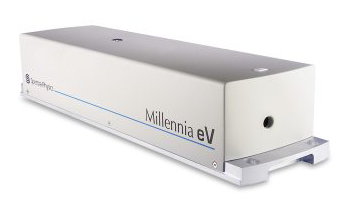
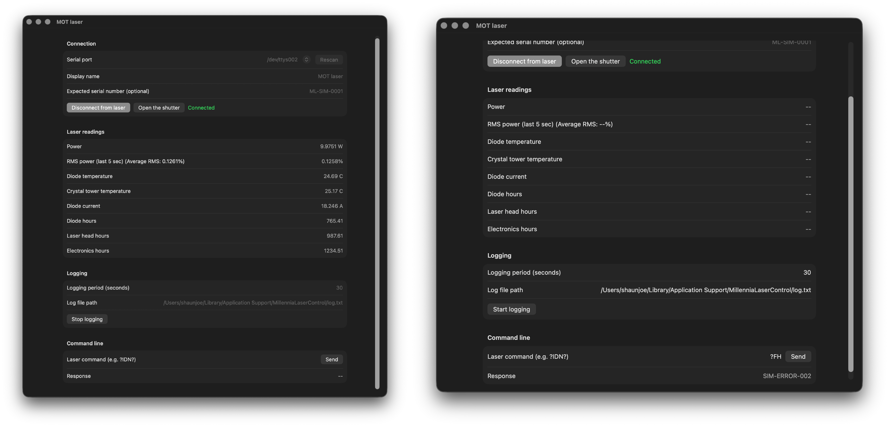

# Millennia Laser Control App for macOS

A native SwiftUI app for monitoring and controlling Spectra-Physics Millennia eV lasers from macOS over a USB serial connection. This project is a Swift port of the [original Millennia Laser Control App](https://github.com/alberti42/Millennia-Laser-Control-App), adapted for Mac users.





For information about the laser, see the [Spectra-Physics Millennia eV product page](https://www.spectra-physics.com/f/millennia-ev-cw-dpss-laser).

## Features

- Connect to a Millennia eV laser through a serial port and optionally verify its serial number.
- View laser power, five-second RMS power with the average RMS shown alongside it, temperatures, diode current, and operating hours.
- Open or close the laser shutter and send device commands.
- Log readings and laser error history to a tab-separated text file at a configurable interval.
- Save the connection and logging settings between launches.
- Test the app without laser hardware using the included virtual laser simulator.

## Requirements

- macOS 13 or later
- Swift compiler and `make` (available with Xcode or the Xcode Command Line Tools)
- A compatible Millennia eV laser connected over USB for hardware operation

## Build and run

From the project directory, build the app bundle:

```sh
make
```

Open the app:

```sh
make run
```

The app scans `/dev` for serial ports. Choose the port for the laser, optionally enter its expected serial number, and select **Connect to laser**. Use **Rescan** if the laser is connected after the app opens.

## Try the app without a laser

Build and launch the virtual laser in a Terminal window:

```sh
make simulator
./build/millennia-simulator
```

The simulator prints the path of its virtual serial port (for example, `/dev/ttys004`). Leave the simulator running, select that port in the app, and connect. It provides simulated readings for the app's supported queries. Its default serial number is `ML-SIM-0001`; the app's expected serial number field is blank by default, so it accepts any serial number unless you enter one.

To use a custom serial number, pass it to the simulator and enter the same value in the app:

```sh
./build/millennia-simulator --serial-number TEST-123
```

Leave the app's expected serial number field empty to accept any detected serial number.

To simulate fault-history changes, use `--errors` with the number of changes and `--error-period` with the duration in seconds. The simulator starts with a `000` response to `?FH`, then advances through simulated error codes evenly across the specified period. Query `?FH` in the app's **Command line** section, or start logging to have the app poll fault history automatically:

```sh
./build/millennia-simulator --errors 5 --error-period 60
```

This example advances through five simulated error codes over 60 seconds. Both options must be provided together, and the period must be greater than zero. The options can be combined with `--serial-number`.

## Logging and settings

Set the logging interval in seconds and choose a log file path in the app. The RMS power value is calculated from the latest five seconds of readings; the adjacent **Average RMS** label shows the mean RMS value accumulated during the current logging interval. Each logging session appends a session header and tab-separated readings, including the timestamp, power, RMS values, temperatures, current, operating hours, and error status.

The default configuration and log locations are:

```text
~/Library/Application Support/MillenniaLaserControl/config.txt
~/Library/Application Support/MillenniaLaserControl/log.txt
```

Settings are saved to the configuration file automatically. To use a different configuration file, launch the app with `-config` followed by its path. Add `-start` to connect and begin logging automatically when the app launches:

```sh
open MillenniaControlApp.app --args -config "/path/to/config.txt" -start
```

The configuration file is plain text. For example:

```text
logFilePath = /path/to/log.txt
logPeriod = 30
comPort = /dev/cu.usbserial
laserName = My Millennia
serialNumber = 2675
```

## Original project

The original application and its Windows build instructions are available in the [Millennia Laser Control App repository](https://github.com/alberti42/Millennia-Laser-Control-App). This repository contains the macOS Swift port and its simulator.
